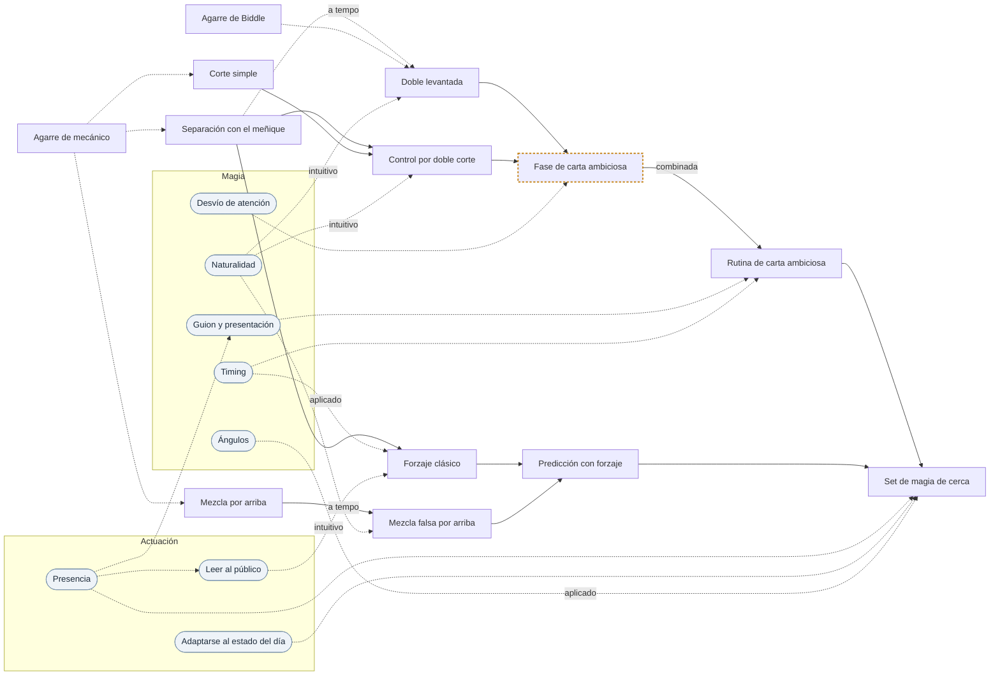

# Vía · Cartomagia · Hasta un set de magia de cerca

> Generado por `herramientas/vias.py` a partir de `datos/`. Edita los datos, no este archivo.

**Objetivo:** Set de magia de cerca.
**Recorrido:** 13 piezas y 13 conceptos del dominio. Las marcadas con ⚑ piden revisión de alguien que lo practique.

## Mapa

Cada flecha va de lo que hace falta antes a lo que se apoya en ello. Continua: está compuesto de. Discontinua: requiere. Los óvalos son los conceptos del dominio que piden las piezas; sus propios fundamentos están en la tabla del final.

## Recorrido

Ordenado para que nada aparezca antes que aquello en lo que se apoya. Cada paso pasa por el bucle: aislar, lento, preciso, a tempo, combinar.

1. **Agarre de Biddle** · agarre · agarres, cortes y mezclas reales
   La baraja sujeta desde arriba por la mano derecha, por los extremos.  

2. **Agarre de mecánico** · agarre · agarres, cortes y mezclas reales
   La baraja en la mano izquierda, con el índice en el borde delantero.  

3. **Corte simple** · movimiento · agarres, cortes y mezclas reales
   Requiere: Agarre de mecánico.  

4. **Mezcla por arriba** · movimiento · agarres, cortes y mezclas reales
   La mezcla de toda la vida, de mano a mano.  
   Requiere: Agarre de mecánico.  

5. **Separación con el meñique** · movimiento · controles
   Mantener una pequeña separación en la baraja con la yema del meñique.  
   Requiere: Agarre de mecánico.  
   Mide: ángulos.  

6. **Doble levantada** · movimiento · levantadas
   Levantar dos cartas como si fueran una.  
   Requiere: Separación con el meñique (a tempo), Agarre de Biddle, Naturalidad (intuitivo).  
   Mide: naturalidad, limpieza.  

7. **Control por doble corte** · técnica · controles
   Llevar la carta elegida arriba con dos cortes que parecen uno normal.  
   Hecho de: Separación con el meñique, Corte simple.  
   Requiere: Naturalidad (intuitivo).  
   Mide: naturalidad.  

8. **Forzaje clásico** · técnica · forzajes
   El espectador «elige libremente» la carta que tú quieres, al pasar las cartas de una mano a otra.  
   Hecho de: Separación con el meñique.  
   Requiere: Timing (aplicado), Leer al público (intuitivo).  
   Mide: timing, naturalidad.  

9. **Mezcla falsa por arriba** · técnica · mezclas y cortes falsos
   Parece una mezcla, pero la carta de arriba sigue en su sitio.  
   Hecho de: Mezcla por arriba (a tempo).  
   Requiere: Naturalidad.  
   Mide: naturalidad.  

10. **Fase de carta ambiciosa** ⚑ · efecto · presentación
   La carta elegida, metida en el centro, vuelve arriba.  
   Hecho de: Doble levantada, Control por doble corte.  
   Requiere: Desvío de atención.  
   Realiza: Transposición.  

11. **Predicción con forzaje** · efecto · presentación
   La carta que elige el espectador estaba escrita de antemano.  
   Hecho de: Forzaje clásico, Mezcla falsa por arriba.  
   Realiza: Predicción.  

12. **Rutina de carta ambiciosa** · rutina · presentación
   Varias fases encadenadas con progresión y un final fuerte.  
   Hecho de: Fase de carta ambiciosa (combinada).  
   Requiere: Guion y presentación, Timing.  
   Mide: presentación, timing.  

13. **Set de magia de cerca** · espectáculo · presentación
   Diez minutos para un grupo pequeño; abrir, encadenar dos rutinas y cerrar.  
   Hecho de: Rutina de carta ambiciosa, Predicción con forzaje.  
   Requiere: Presencia, Adaptarse al estado del día, Ángulos (aplicado).  
   Mide: presentación, ángulos.  

## Lo que necesitas del dominio

El grado es el más alto que pide algún paso de la ruta. Sin grado: basta con tenerlo de base.

| Concepto | Dominio | Grado | Lo piden |
| --- | --- | --- | --- |
| Gestión de la atención | Actuación | — | Desvío de atención |
| Gestión del nervio | Actuación | — | Repertorio fijo |
| Presencia | Actuación | — | Leer al público, Guion y presentación, Set de magia de cerca |
| Leer al público | Actuación | intuitivo | Forzaje clásico |
| Repertorio fijo | Actuación | — | Adaptarse al estado del día |
| Adaptarse al estado del día | Actuación | — | Set de magia de cerca |
| Efecto | Magia | — | Timing, Guion y presentación |
| Guion y presentación | Magia | — | Rutina de carta ambiciosa |
| Método | Magia | — | Naturalidad, Ángulos, Desvío de atención y 1 más |
| Desvío de atención | Magia | — | Fase de carta ambiciosa |
| Naturalidad | Magia | intuitivo | Doble levantada, Control por doble corte, Mezcla falsa por arriba |
| Timing | Magia | aplicado | Forzaje clásico, Rutina de carta ambiciosa |
| Ángulos | Magia | aplicado | Set de magia de cerca |

## Indicadores de cartomagia

- **Limpieza**
- **Naturalidad**: El gesto secreto es igual que el gesto normal.
- **Ángulos**: Resiste desde dónde mira el público.
- **Timing**
- **Presentación**
