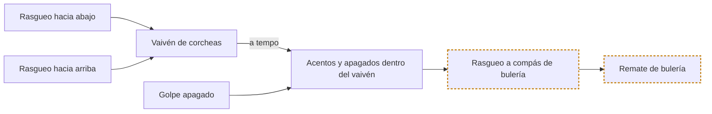

# Vía · Guitarra · Bulería

> Generado por `herramientas/vias.py` a partir de `datos/`. Edita los datos, no este archivo.

**Objetivo:** las piezas de guitarra que caracterizan la bulería (2).
**Recorrido:** 7 piezas y 0 conceptos del dominio. Las marcadas con ⚑ piden revisión de alguien que lo practique.

## Mapa

Cada flecha va de lo que hace falta antes a lo que se apoya en ello. Continua: está compuesto de. Discontinua: requiere. Los óvalos son los conceptos del dominio que piden las piezas; sus propios fundamentos están en la tabla del final.

## Recorrido

Ordenado para que nada aparezca antes que aquello en lo que se apoya. Cada paso pasa por el bucle: aislar, lento, preciso, a tempo, combinar.

1. **Golpe apagado** · golpe · apagados y golpes percusivos
   Rasguear soltando la presión de la mano izquierda para que suene seco, sin nota.  

2. **Rasgueo hacia abajo** · golpe · rasgueo

3. **Rasgueo hacia arriba** · golpe · rasgueo

4. **Vaivén de corcheas** · célula · rasgueo
   Abajo-arriba continuo en corcheas; la mano no para aunque no toque.  
   Hecho de: Rasgueo hacia abajo, Rasgueo hacia arriba.  
   Realiza: Subdivisión.  
   Mide: tempo, limpieza.  

5. **Acentos y apagados dentro del vaivén** · célula · apagados y golpes percusivos
   Sin parar el vaivén, elegir qué golpes suenan, cuáles se apagan y cuáles se acentúan.  
   Hecho de: Vaivén de corcheas (a tempo), Golpe apagado.  
   Realiza: Acento, Contratiempo y síncopa.  
   Mide: limpieza, cuadratura.  

6. **Rasgueo a compás de bulería** ⚑ · patrón · rasgueo
   Marcar el ciclo de doce con los acentos en su sitio.  
   Hecho de: Acentos y apagados dentro del vaivén.  
   Realiza: Compás de bulería.  

7. **Remate de bulería** ⚑ · patrón · rasgueo
   Hecho de: Rasgueo a compás de bulería.  
   Realiza: Remate.  

## Lo que necesitas del dominio

El grado es el más alto que pide algún paso de la ruta. Sin grado: basta con tenerlo de base.

| Concepto | Dominio | Grado | Lo piden |
| --- | --- | --- | --- |

## Indicadores de guitarra

- **Tempo**: Velocidad a la que sale limpio, medida con metrónomo.
- **Limpieza**: Que suene lo que tiene que sonar y calle lo que tiene que callar.
- **Cuadratura**: Encaje con el patrón rector del estilo (la clave, el compás de 12).
- **Dinámica**: Capacidad de subir y bajar intensidad sin perder el patrón.
- **Soltura**: Tocarlo sin mirar, hablando o cantando encima.
