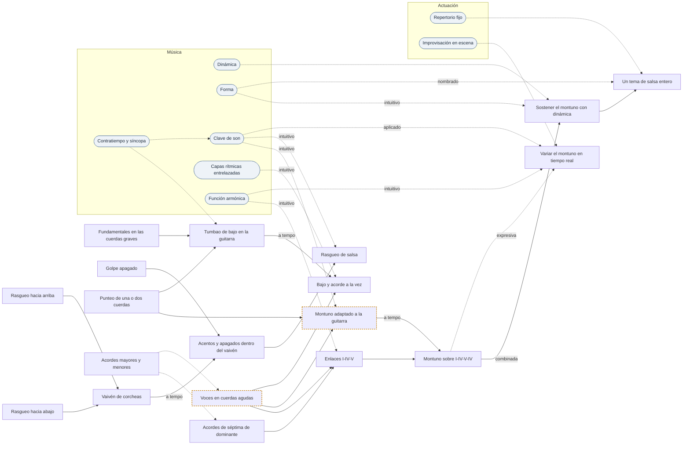

# Vía · Guitarra · Salsa

> Generado por `herramientas/vias.py` a partir de `datos/`. Edita los datos, no este archivo.

**Objetivo:** las piezas de guitarra que caracterizan la salsa (8).
**Recorrido:** 19 piezas y 22 conceptos del dominio. Las marcadas con ⚑ piden revisión de alguien que lo practique.

## Mapa

Cada flecha va de lo que hace falta antes a lo que se apoya en ello. Continua: está compuesto de. Discontinua: requiere. Los óvalos son los conceptos del dominio que piden las piezas; sus propios fundamentos están en la tabla del final.

## Recorrido

Ordenado para que nada aparezca antes que aquello en lo que se apoya. Cada paso pasa por el bucle: aislar, lento, preciso, a tempo, combinar.

1. **Fundamentales en las cuerdas graves** · nota · punteo y bajos
   Encontrar sin pensar la nota raíz de cada acorde en la sexta y la quinta cuerda.  
   Realiza: Altura.  

2. **Golpe apagado** · golpe · apagados y golpes percusivos
   Rasguear soltando la presión de la mano izquierda para que suene seco, sin nota.  

3. **Punteo de una o dos cuerdas** · golpe · punteo y bajos
   Pulsar notas sueltas con dedos o púa en vez de rasguear.  

4. **Rasgueo hacia abajo** · golpe · rasgueo

5. **Rasgueo hacia arriba** · golpe · rasgueo

6. **Acordes mayores y menores** · acorde · acordes y posiciones
   Posiciones abiertas y con cejilla.  
   Realiza: Acorde.  

7. **Acordes de séptima de dominante** · acorde · acordes y posiciones
   Requiere: Acordes mayores y menores.  
   Realiza: Acorde.  

8. **Vaivén de corcheas** · célula · rasgueo
   Abajo-arriba continuo en corcheas; la mano no para aunque no toque.  
   Hecho de: Rasgueo hacia abajo, Rasgueo hacia arriba.  
   Realiza: Subdivisión.  
   Mide: tempo, limpieza.  

9. **Acentos y apagados dentro del vaivén** · célula · apagados y golpes percusivos
   Sin parar el vaivén, elegir qué golpes suenan, cuáles se apagan y cuáles se acentúan.  
   Hecho de: Vaivén de corcheas (a tempo), Golpe apagado.  
   Realiza: Acento, Contratiempo y síncopa.  
   Mide: limpieza, cuadratura.  

10. **Voces en cuerdas agudas** ⚑ · acorde · acordes y posiciones
   Acordes de tres o cuatro cuerdas agudas, para dejar sitio al bajo y sonar más ligero.  
   Requiere: Acordes mayores y menores.  
   Realiza: Acorde.  

11. **Enlaces I-IV-V** · enlace · acordes y posiciones
   Pasar entre tónica, subdominante y dominante sin cortar el ritmo.  
   Hecho de: Voces en cuerdas agudas, Acordes de séptima de dominante.  
   Requiere: Función armónica (intuitivo).  
   Realiza: Función armónica.  
   Mide: tempo, soltura.  

12. **Montuno adaptado a la guitarra** ⚑ · patrón · punteo y bajos
   Notas del acorde en contratiempo, a la manera del tres o del piano.  
   Hecho de: Punteo de una o dos cuerdas, Voces en cuerdas agudas.  
   Requiere: Clave de son (intuitivo).  
   Realiza: Montuno (guajeo).  
   Mide: cuadratura, limpieza.  

13. **Rasgueo de salsa** · patrón · acompañamiento
   Acentos y apagados colocados para encajar con la clave.  
   Hecho de: Acentos y apagados dentro del vaivén.  
   Requiere: Clave de son (intuitivo).  
   Realiza: Patrón rítmico.  
   Mide: cuadratura, tempo.  

14. **Tumbao de bajo en la guitarra** · patrón · punteo y bajos
   Bajo anticipado en las cuerdas graves, en el «y» del 2 y en el 4.  
   Hecho de: Punteo de una o dos cuerdas, Fundamentales en las cuerdas graves.  
   Requiere: Contratiempo y síncopa.  
   Realiza: Tumbao de bajo.  
   Mide: cuadratura.  

15. **Bajo y acorde a la vez** · ciclo · acompañamiento
   Tumbao de bajo con el pulgar y acordes agudos con los dedos; una sola guitarra hace dos papeles.  
   Hecho de: Tumbao de bajo en la guitarra (a tempo), Voces en cuerdas agudas.  
   Requiere: Capas rítmicas entrelazadas (intuitivo).  
   Realiza: Textura.  

16. **Montuno sobre I-IV-V-IV** · ciclo · acompañamiento
   El montuno o el rasgueo recorriendo la progresión entera, vuelta tras vuelta, sin perder la clave.  
   Hecho de: Montuno adaptado a la guitarra (a tempo), Enlaces I-IV-V.  
   Realiza: Progresión.  
   Mide: tempo, cuadratura, soltura.  

17. **Sostener el montuno con dinámica** · sección · acompañamiento
   Acompañar la sección de coro y pregón subiendo y bajando la intensidad según la canción.  
   Hecho de: Montuno sobre I-IV-V-IV (combinada).  
   Requiere: Dinámica, Forma (intuitivo).  
   Mide: dinámica, soltura.  

18. **Variar el montuno en tiempo real** · sección · improvisación
   Adornos, huecos y respuestas al pregón sin salirse de la clave.  
   Requiere: Montuno sobre I-IV-V-IV (expresiva), Clave de son (aplicado), Función armónica (intuitivo), Improvisación en escena.  
   Mide: cuadratura, dinámica.  

19. **Un tema de salsa entero** · tema · acompañamiento
   Tema, montuno, mambo y final, de principio a fin y delante de alguien.  
   Hecho de: Sostener el montuno con dinámica.  
   Requiere: Forma (nombrado), Repertorio fijo.  

## Lo que necesitas del dominio

El grado es el más alto que pide algún paso de la ruta. Sin grado: basta con tenerlo de base.

| Concepto | Dominio | Grado | Lo piden |
| --- | --- | --- | --- |
| Gestión del nervio | Actuación | — | Repertorio fijo |
| Presencia | Actuación | — | Leer al público |
| Leer al público | Actuación | aplicado | Improvisación en escena |
| Repertorio fijo | Actuación | — | Adaptarse al estado del día, Un tema de salsa entero |
| Adaptarse al estado del día | Actuación | — | Improvisación en escena |
| Improvisación en escena | Actuación | — | Variar el montuno en tiempo real |
| Altura | Música | — | Intervalo |
| Dinámica | Música | — | Sostener el montuno con dinámica |
| Forma | Música | nombrado | Sostener el montuno con dinámica, Un tema de salsa entero |
| Intervalo | Música | — | Escala, Acorde |
| Acorde | Música | — | Función armónica |
| Escala | Música | — | Tonalidad |
| Pulso | Música | — | Subdivisión, Compás |
| Compás | Música | — | Acento, Clave de son |
| Acento | Música | — | Contratiempo y síncopa |
| Subdivisión | Música | — | Contratiempo y síncopa |
| Contratiempo y síncopa | Música | — | Patrón rítmico, Clave de son, Tumbao de bajo en la guitarra |
| Clave de son | Música | aplicado | Rasgueo de salsa, Montuno adaptado a la guitarra, Variar el montuno en tiempo real |
| Patrón rítmico | Música | — | Capas rítmicas entrelazadas |
| Capas rítmicas entrelazadas | Música | intuitivo | Bajo y acorde a la vez |
| Tonalidad | Música | — | Función armónica |
| Función armónica | Música | intuitivo | Enlaces I-IV-V, Variar el montuno en tiempo real |

## Indicadores de guitarra

- **Tempo**: Velocidad a la que sale limpio, medida con metrónomo.
- **Limpieza**: Que suene lo que tiene que sonar y calle lo que tiene que callar.
- **Cuadratura**: Encaje con el patrón rector del estilo (la clave, el compás de 12).
- **Dinámica**: Capacidad de subir y bajar intensidad sin perder el patrón.
- **Soltura**: Tocarlo sin mirar, hablando o cantando encima.
