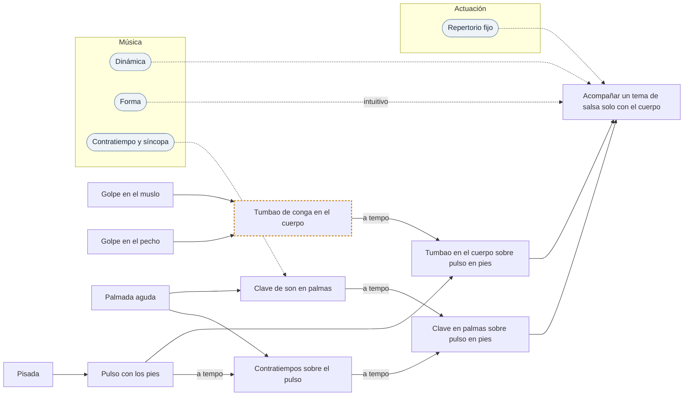

# Vía · Percusión corporal · Salsa

> Generado por `herramientas/vias.py` a partir de `datos/`. Edita los datos, no este archivo.

**Objetivo:** las piezas de percusión corporal que caracterizan la salsa (5).
**Recorrido:** 11 piezas y 9 conceptos del dominio. Las marcadas con ⚑ piden revisión de alguien que lo practique.

## Mapa

Cada flecha va de lo que hace falta antes a lo que se apoya en ello. Continua: está compuesto de. Discontinua: requiere. Los óvalos son los conceptos del dominio que piden las piezas; sus propios fundamentos están en la tabla del final.

## Recorrido

Ordenado para que nada aparezca antes que aquello en lo que se apoya. Cada paso pasa por el bucle: aislar, lento, preciso, a tempo, combinar.

1. **Golpe en el muslo** · sonido · muslos y pecho

2. **Golpe en el pecho** · sonido · muslos y pecho
   El sonido más grave del cuerpo; hace de bombo o de tono abierto.  

3. **Palmada aguda** · sonido · manos y palmas
   Dedos sobre la palma, seca y brillante.  

4. **Pisada** · sonido · pies

5. **Pulso con los pies** · célula · pies
   Pisadas alternas marcando el pulso mientras las manos van libres.  
   Hecho de: Pisada.  
   Realiza: Pulso.  
   Mide: tempo.  

6. **Contratiempos sobre el pulso** · célula · coordinación e independencia
   Los pies siguen en el pulso mientras las manos tocan fuera de él.  
   Hecho de: Pulso con los pies (a tempo), Palmada aguda.  
   Realiza: Contratiempo y síncopa.  
   Mide: independencia.  

7. **Clave de son en palmas** · patrón · manos y palmas
   Hecho de: Palmada aguda.  
   Requiere: Contratiempo y síncopa.  
   Realiza: Clave de son.  
   Mide: cuadratura, claridad de sonidos.  

8. **Tumbao de conga en el cuerpo** ⚑ · patrón · muslos y pecho
   Los tonos abiertos en el pecho y los golpes secos en el muslo.  
   Hecho de: Golpe en el pecho, Golpe en el muslo.  
   Realiza: Tumbao de conga.  

9. **Clave en palmas sobre pulso en pies** · ciclo · coordinación e independencia
   Hecho de: Clave de son en palmas (a tempo), Contratiempos sobre el pulso (a tempo).  
   Realiza: Capas rítmicas entrelazadas.  
   Mide: independencia, cuadratura.  

10. **Tumbao en el cuerpo sobre pulso en pies** · ciclo · coordinación e independencia
   Hecho de: Tumbao de conga en el cuerpo (a tempo), Pulso con los pies.  
   Realiza: Capas rítmicas entrelazadas.  

11. **Acompañar un tema de salsa solo con el cuerpo** · pieza · coordinación e independencia
   Entrar, sostener, variar la intensidad y cerrar.  
   Hecho de: Clave en palmas sobre pulso en pies, Tumbao en el cuerpo sobre pulso en pies.  
   Requiere: Dinámica, Forma (intuitivo), Repertorio fijo.  
   Mide: dinámica.  

## Lo que necesitas del dominio

El grado es el más alto que pide algún paso de la ruta. Sin grado: basta con tenerlo de base.

| Concepto | Dominio | Grado | Lo piden |
| --- | --- | --- | --- |
| Gestión del nervio | Actuación | — | Repertorio fijo |
| Repertorio fijo | Actuación | — | Acompañar un tema de salsa solo con el cuerpo |
| Dinámica | Música | — | Acompañar un tema de salsa solo con el cuerpo |
| Forma | Música | intuitivo | Acompañar un tema de salsa solo con el cuerpo |
| Pulso | Música | — | Subdivisión, Compás |
| Compás | Música | — | Acento |
| Acento | Música | — | Contratiempo y síncopa |
| Subdivisión | Música | — | Contratiempo y síncopa |
| Contratiempo y síncopa | Música | — | Clave de son en palmas |

## Indicadores de percusión corporal

- **Tempo**
- **Claridad de sonidos**: Que cada sonido se distinga del resto.
- **Independencia**: Manos y pies haciendo cosas distintas sin arrastrarse.
- **Cuadratura**
- **Dinámica**
